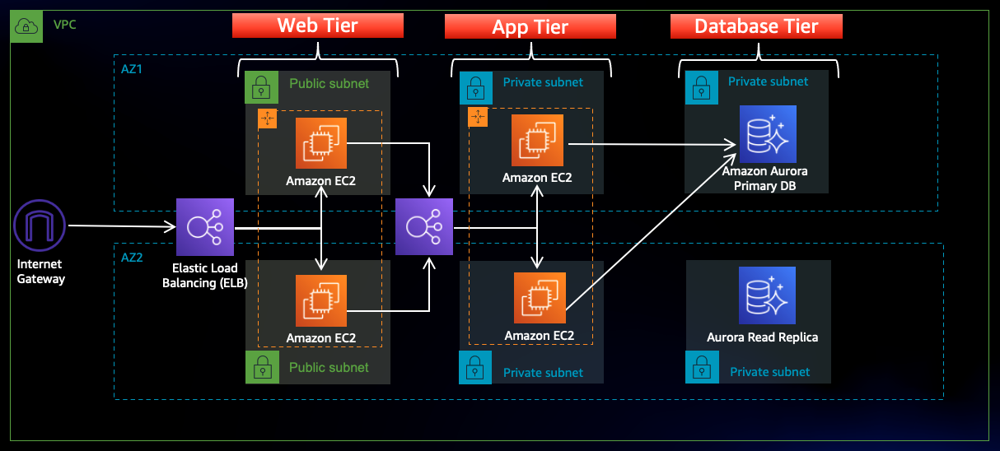
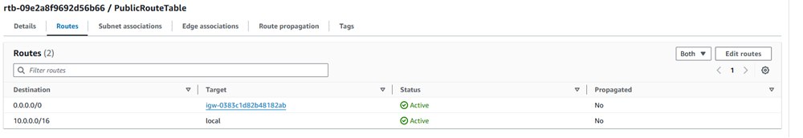
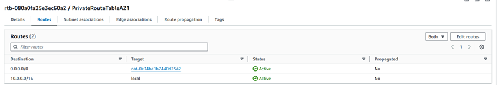
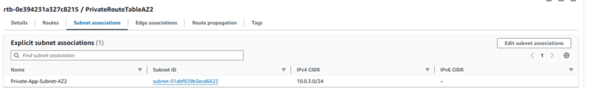
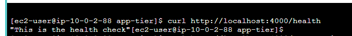
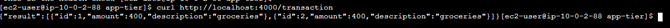
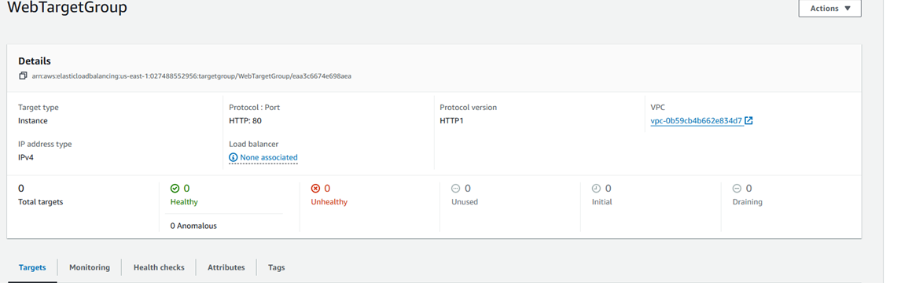
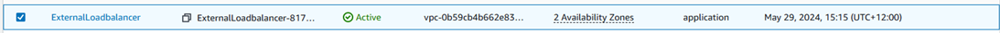
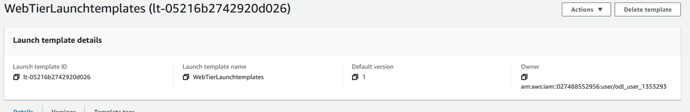
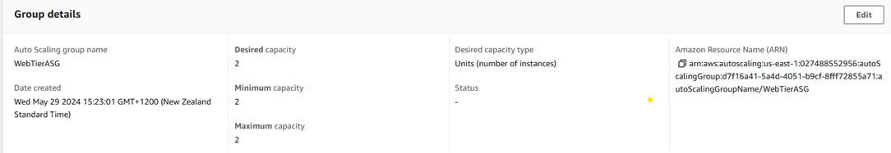

# Deploy a 3 Tier Architecture Webapp on AWS 

## Architecture overview

In this architecture, a public-facing Application Load Balancer forwards client traffic to our web tier EC2 instances. The web tier is running Nginx webservers that are configured to serve a React.js website and redirects our API calls to the application tier’s internal facing load balancer. The internal facing load balancer then forwards that traffic to the application tier, which is written in Node.js. The application tier manipulates data in an Aurora MySQL multi-AZ database and returns it to our web tier. Load balancing, health checks and auto scaling groups are created at each layer to maintain the availability of this architecture.

### Set Up 
In this task we will be downloading the code from [Github](https://github.com/aws-samples/aws-three-tier-web-architecture-workshop.git ) and upload it to amazon S3 bucket so our instances can access it. We will also create an AWS Identity and Access Management EC2 role so we can use AWS Systems Manager Session Manager to connect to our instances securely and without needing to create SSH key pairs

- S3 Bucket Created and named mywebapp-ashish-101
- Created IAM EC2 Instance role and named Project-ec2role
- Permission policies AmazonSSMManagedInstanceCore and AmazonS3ReadOnlyAccess added to Project-ec2role

## Networking and Security

### VPC
   - **Project-vpc with IPV4 CIDER (10.0.0.0/16)**
#### Subnets

  To achieve high availability we have created subnets in two different zones 

  - Public-Web-Subnet-AZ1 (10.0.0.0/24)
  - Public-Web-Subnet-AZ2 (10.0.1.0/24)

  - Private-App-Subnet-AZ1 (10.0.2.0/24)
  - Private-App-Subnet-AZ2 (10.0.3.0/24)

  - Private-DB-Subnet-AZ1 (10.0.4.0/24)
  - Private-DB-Subnet-AZ2 (10.0.5.0/24)
#### Internet connectivity
To give the public subnets in our VPC internet access we have created internet gateway **(“Project-IGW”)** and   attached to our **VPC “Project-vpc”**.

#### NAT Gateway

We will use NAT Gateway for private Instances to access internet through the secure gateway channel. We have created two NAT gateways (NAT-GW-AZ1, NAT-GW-AZ2) due to multi AZ.

#### Routing Configuration  
Three dedicated route tables have been provisioned as part of the network routing setup, as outlined below.

**PublicRouteTable**


**PrivateRouteTableAZ1**


**PrivateRouteTableAZ2**


#### Security Groups
We will create some Security groups which will filter the traffic be to our Elastic Load Balancers and EC2 instances. So we have created security groups as given below
  
  - WebTierSG
  - Privateinstances-sg
  - DB-SG
  - Internet-facing-lb-sg
  - Internal-lb-sg

## Database Deployment

  - Subnet Groups  created **“project-db-subnet-group”**
  - Database Deployment **“ArouraDB/MySQL”** RDS Writer endpoint **“database-1-instance-1.cznsyzczkkou.us-east- 1.rds.amazonaws.com”**

## App Tier Instance Deployment
  
**App Instance Deployment**

  - Launched an EC2 instance with Amazon Linux image named as App-server
  
**Connect to Instance**

  - Connected to app-server using session manager.
  - Login as ec2-user

**To Configure Database we will use the following commands**

```
sudo wget https://dev.mysql.com/get/mysql57-community-release-el7-11.noarch.rpm
sudo rpm --import https://repo.mysql.com/RPM-GPG-KEY-mysql-2022
sudo yum install https://dev.mysql.com/get/mysql57-community-release-el7-11.noarch.rpm 
sudo yum install mysql –y

```
**To Initiate DB connection with your Aurora RDS writer endpoint. In the following command, we will replace the RDS writer endpoint and the username, and then execute it in the browser terminal:**
```
mysql -h database-1-instance-1.cznsyzczkkou.us-east-1.rds.amazonaws.com -u admin -p
CREATE DATABASE webappdb;
SHOW DATABASES;
USE webappdb;    

```
**To create the transactions table we will use this create table command:**
```
CREATE TABLE IF NOT EXISTS transactions(id INT NOT NULL
AUTO_INCREMENT, amount DECIMAL(10,2), description
VARCHAR(100), PRIMARY KEY(id));  
SHOW TABLES;  

```
**To insert data into the table we will use the following command**
```
INSERT INTO transactions (amount,description) VALUES ('400','groceries');  
```
**To verify if the data was added by executing the following command:**
```
SELECT * FROM transactions;
```
**Configure App Instance**

Now upload the app-tier files to our S3 bucket **(mywebapp-ashish-101)** before upload files we need to modify the DbConfig.js file. After upload the app-tier folder to **mywebapp-ashish-101** we need to install all of the necessary components to run our backend application. 

- Start by installing NVM (node version manager)
  
  ```
  curl -o- https://raw.githubusercontent.com/nvm-sh/nvm/v0.38.0/install.sh | bash
  source ~/.bashrc
  nvm install 16
  nvm use 16
  ```

- Install PM2 a daemon process manager which will keep our node.js app running when we exit the instance or if it is rebooted.
  ```
  npm install -g pm2  
  ```

- Now download our code from our s3 buckets onto our instance. To download our code we will use these commands
  ```
  cd ~/ aws s3 cp s3://mywebapp-ashish-101/app-tier/ app-tier –recursive
  ls –lrt  to check if the code has downloaded 
  cd app-tier
  npm install
  pm2 start index.js
  pm2 list  To make sure the app is running correctly
  pm2 logs To check if app shows error
  pm2 startup
  pm2 save

  ```

- Test APP Tier

  curl http://localhost:4000/health should show result as
  
  

  curl http://localhost:4000/transaction should show 

  

## Internal Load Balancing and Auto Scaling

#### App Tier AMI
Created App tier AMI from the App-server named as “App-sever image”
#### Target Group
Created target group for the app tier named as AppTierTargetGroup
#### Internal load Balancer
Created internal load balancer as “Internal-Loadbalancer”
#### Launch Template
Created launch template app tier named as “Apptier-Launchtemplate”
#### Auto Scaling
Created auto scaling group named as App-Tier-ASG

## Web Tier Instance Deployment 

#### Update Config File
Before create and configure the web instances, we need to update application-code/nginx.conf file from the repo we downloaded. We need to replace [INTERNAL-LOADBALANCER-DNS] with our internal load balancer’s DNS.
#### Web Instance Deployment
Launched EC2 instance with Amazon Linux image names as Web-sever under our project-vpc using Web-Tier subnet
#### Connect to Instance

- Connect to Web-server using session manager.
- Login as ec2-user

#### Configure Web Instance
Now its time to install all of the necessary components needed to run our front-end application
```
curl -o- https://raw.githubusercontent.com/nvm-sh/nvm/v0.38.0/install.sh | bash
source ~/.bashrc
nvm install 16
nvm use 16
```
#### Download web tier code
To download web tier code from our s3 bucket use the following command
```
aws s3 cp s3://mywebapp-ashish-101/web-tier/ web-tier –recursive
```
Navigate to the web-layer folder and create the build folder for the react app so we can serve our code
```
cd web-tier
npm install 
npm run build
```
As NGINX is utilized as the web server for the application tier. It is configured to serve the application over port 80 and to route API requests securely to the internal load balancer for backend processing.

To install and configure Nginx run the following commands
```
Sudo yum install ngnix -y
cd /etc/nginx
ls
sudo rm nginx.conf #(make sure to make a backup of ngnix.conf before delete it)#
sudo aws s3 cp s3:// mywebapp-ashish-101/nginx.conf 
sudo service nginx restart
chmod -R 755 /home/ec2-user
sudo chkconfig nginx on

```
## External Load Balancer and Auto Scaling
External Load Balancer and Auto Scaling components

#### Web Tier AMI
Created Web Tier image named as Web-serverImange

#### Target Group
Created target group as WebTargetGroup


#### Internet Facing Load Balancer
Created internet facing Loadbalancer (“ExternalLoadBalancer”) to server our frontend web application on HTTP and HTTPS ports. So clients will hit the URL ExternalLoadbalancer-817560048.us-east-1.elb.amazonaws.com to access our frontend application and this Loadbalancer will distribute the traffic to multiple instances running application on


#### Launch Template
Created WebTierLaunchTemplate using Web-serverImage


#### Auto Scaling group 
Created Web-Tier ASG using WebTierLaunchTemplate and defined the desired capacities as given below


### References:-
https://catalog.us-east-1.prod.workshops.aws/workshops/85cd2bb2-7f79-4e96-bdee-8078e469752a/en-US/part6/createami 
Project2 - Deploy a 3 Tier Architecture On AWS - End to End Project Demo (youtube.com)

